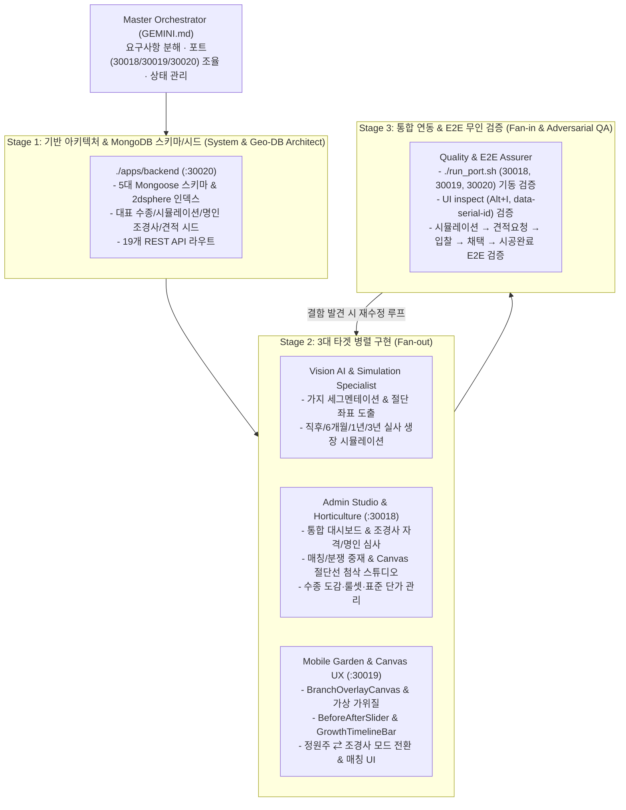

# 멀티에이전트 오케스트레이션 파이프라인 규격 (Orchestration Pipeline Rules)

- **기준 문서**: [docs/PRDs/WORK_ORDER.md](file:///apps/ex_project_GajiTalk/docs/PRDs/WORK_ORDER.md)
- **적용 포트 및 디렉토리**:
  - `./apps/mobile-app` (Port **`30018`**): 정원주(고객) & 조경사(파트너) 모바일 웹/앱 (React + Vite)
  - `./apps/admin-web` (Port **`30019`**): 통합 관리자 웹 & 전문가 Canvas 첨삭 스튜디오 (React + Vite)
  - `./apps/backend` (Port **`30020`**): Node.js + Express/NestJS + MongoDB REST API & AI/매칭 서버

---

## 1. 오케스트레이션 아키텍처 개요

본 프로젝트는 `WORK_ORDER.md`의 요구사항을 완결성 있게 달성하기 위해 **파이프라인(Pipeline)** + **분산·통합(Fan-out / Fan-in)** + **생성·검증(Producer-Reviewer)** 하이브리드 오케스트레이션 패턴을 채택합니다.

---

## 2. 전담 에이전트 역할 및 입출력 계약 (Agent Contracts)

| 에이전트 롤 | 모델 티어 | 담당 경로 및 포트 | 핵심 입력 (Input) | 핵심 산출물 (Output) |
| :--- | :--- | :--- | :--- | :--- |
| **1. System & Geo-DB Architect** | Gemini Pro | `./apps/backend` (`:30020`), 루트 설정 | `WORK_ORDER.md` 2, 4, 5, 6장 | `apps/*` 모노레포 구조, 5대 Mongoose 모델(`User`, `Garden`, `PruningSimulation`, `MatchingRequest`, `TreeSpecies`), 시드 러너, `run_port.sh` |
| **2. Vision AI & Simulation Specialist** | Gemini Pro | `./apps/backend/src/services/` (`:30020`) | 수목 원본 사진, 수종 룰셋, 절단 선택 좌표 | `visionAi.service.ts`, `inpaintingAi.service.ts`, `/api/simulations/*` (절단 좌표 & 직후/6개월/1년/3년 실사 합성) |
| **3. Mobile Garden & Canvas UX Specialist** | Gemini Pro/Flash | `./apps/mobile-app` (`:30019`) | 시뮬레이션 API, 내 정원 API, UI inspect 규격 | `BranchOverlayCanvas`, `BeforeAfterSlider`, `GrowthTimelineBar`, `CaptureAndAnalyzePage`, `SimulationResultPage`, `MyGardenPage` |
| **4. O2O Matching & Bidding Specialist** | Gemini Pro/Flash | `./apps/mobile-app` (`:30019`) & `./apps/backend` (`:30020`) | 매칭/견적 API, 조경사 디렉토리 | `LandscaperCard`, `QuoteRequestModal`, `QuoteComparisonList`, `LandscaperDirectoryPage`, `MatchingStatusPage`, `PartnerJobBoardPage` |
| **5. Admin Studio & Horticulture Specialist** | Gemini Pro/Flash | `./apps/admin-web` (`:30018`) | Admin API (`/api/admin/*`) | `DashboardPage`, `MatchingManagePage`, `LandscaperVerifyPage`, `SimulationReviewPage`(Canvas 에디터), `SpeciesManagePage` |
| **6. Quality & E2E Assurer** | Gemini Pro | `./tests/`, 전체 포트 (`:30018`, `:30019`, `:30020`) | `WORK_ORDER.md` 8장 검수 기준 | Playwright E2E 테스트 및 화면 캡처 슈트, API/UI 실시간 연동 무결성 리포트 |

---

## 3. 단계별(Phase 1~3) 오케스트레이션 실행 프로토콜

### Phase 1: 핵심 프로토타입(MVP) 및 매칭 플로우 시연 버전 구축
1. **백엔드 & DB 시드 구축 (`./apps/backend`, Port `30020`)**:
   - 대표 조경수(소나무/반송, 단풍나무, 배롱나무, 유실수 등)의 실사 전지 전/후 및 6개월·1년·3년 생장 예측 데이터 시드 구성.
   - 샘플 '명인 조경사' 프로필(`isMasterBadge: true`), Before/After 시공 포트폴리오, 정원주 견적 요청 및 조경사 입찰 샘플 데이터 시드 투입.
   - 19개 REST API 엔드포인트 구동 및 CORS/프록시(`:30018`, `:30019` ↔ `:30020`) 연동.
2. **모바일 앱 핵심 화면 구축 (`./apps/mobile-app`, Port `30019`)**:
   - **AI 실사 조경 시뮬레이터**: 나무 촬영/선택 → 실사 위 절단선(가위 마킹) 오버레이(`BranchOverlayCanvas`) → 가상 가위질 스와이프 → 전지 직후(`BeforeAfterSlider`) 및 6개월/1년/3년 후 실사 생장 비교 슬라이더(`GrowthTimelineBar`).
   - **정원주-조경사 매칭 플로우**: 시뮬레이션 결과 화면에서 `[이 수형대로 전문 조경사에게 견적 받기]` 클릭 → 견적 요청서 작성(`QuoteRequestModal`) → 조경사 입찰 내역(견적가, 상세 내역, 코멘트, 포트폴리오) 비교 및 채택(`QuoteComparisonList`).
   - **조경사 파트너 뷰 전환**: 상단 모드 스위치(`정원주 모드 ⇄ 조경사 파트너 모드`)를 통해 조경사 입장에서 주변 정원 요청서를 확인하고 Canvas 첨삭 및 상세 견적을 발송하는 `PartnerJobBoardPage` 구현.
3. **통합 관리자 웹 구축 (`./apps/admin-web`, Port `30018`)**:
   - 통합 대시보드(`DashboardPage`), 매칭/견적 현황 모니터링 및 수동 배정(`MatchingManagePage`), 조경사 자격 승인 및 명인 배지 관리(`LandscaperVerifyPage`), Canvas 기반 가지치기 절단선 교정 스튜디오(`SimulationReviewPage`), 수종별 전지 룰셋 및 권장 단가 관리(`SpeciesManagePage`) 구현.

### Phase 2: 실시간 AI 비전 & Inpainting 파이프라인 연동
1. 멀티모달 Vision AI 연동으로 임의의 정원 나무 사진에서 도장지·교차지·내향지·하향지·병충해가지 자동 탐지 및 절단 폴리라인(`cutLineCoords`, `branchPolygon`) 추출.
2. Image Inpainting API 연동으로 선택 가지 제거 후 실사 배경 복원(`/api/simulations/:id/re-render`) 및 연차별(6개월/1년/3년) 수관 생장 렌더링 자동화.

### Phase 3: 위치 기반 매칭 고도화 및 결제/정기구독 도입
1. MongoDB `2dsphere` 위치 인덱스를 활용한 내 정원(`gardens.location`) 반경 N km 이내 전문 조경사(`users.landscaperProfile.baseLocation`) 자동 탐색 및 매칭 알림.
2. 시공 완료 보고서(`completionReport`) 확인 후 정산 처리 및 내 정원 수목 타임라인(`gardens.trees.timelineLogs`) 자동 아카이빙, 계절별/월별 정기 관리(`REGULAR_CARE`) 구독 연동.

---

## 4. 품질 게이트 및 완료 약속 (Quality Gate & Completion Criteria)

모든 오케스트레이션 단계는 아래 **3대 검수 기준(Acceptance Criteria)**을 통과해야 완료로 판정합니다:
1. **실사 기반 시각적 몰입감**: 만화풍이 아닌 실제 나무 사진 위에서 절단 부위 마킹(`BranchOverlayCanvas`), 가상 가위질, 전지 직후/6개월/1년/3년 후의 실사 생장 비교(`BeforeAfterSlider`, `GrowthTimelineBar`)가 자연스럽게 동작할 것.
2. **시뮬레이션 → 조경사 매칭의 매끄러운 연결**: 고객이 AI 시뮬레이션으로 확인한 결과물을 원클릭으로 조경사에게 전달하여 견적을 요청하고, 조경사가 입찰한 견적서를 비교·채택하여 시공 완료 리포트까지 이어질 것.
3. **3개 포트(`30018`, `30019`, `30020`) 실시간 연동 및 무결성**: `./apps/admin-web`(`:30018`), `./apps/mobile-app`(`:30019`), `./apps/backend`(`:30020`)의 모든 액션(시뮬레이션 생성/재합성, 정원 등록, 견적 요청, 입찰, 채택, 시공완료, 조경사 승인, 절단선 검수, 수종 단가 수정)이 백엔드 API를 통해 실시간 반영되고 콘솔/네트워크 에러가 0건일 것.

