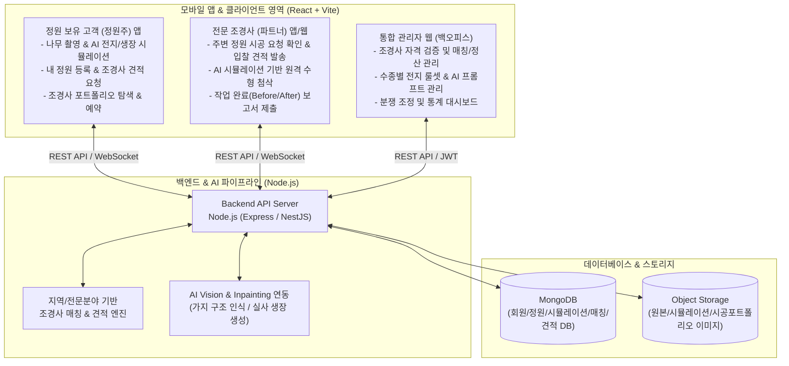

# 조경·수목 전지(가지치기) AI 시뮬레이션 및 정원주-조경사 매칭 플랫폼 작업지시서

## 1. 프로젝트 개요 및 브랜드 아이덴티티

### 1.1 브랜드명 및 앱 명칭 제안 (Brand & App Naming)
서비스의 핵심 가치인 **"AI 실사 수목 전지·생장 시뮬레이션"**과 **"정원주-전문 조경사 O2O 매칭"**을 아우르는 브랜드 및 앱 명칭 후보군입니다.

| 구분 | 브랜드 / 앱 명칭 (한글 / 영문) | 슬로건 (Slogan) | 네이밍 의미 및 특징 |
| :--- | :--- | :--- | :--- |
| **추천 1 (대표안)** | **수형 (SOOHYUNG)**<br/>앱명: **수형 - AI 나무 전지 & 조경사 매칭** | *"찍으면 보이는 나무의 미래, 명인의 손길까지"* | 조경의 핵심인 **'나무의 모양(樹形, 수형)'**을 직관적으로 사용. 소나무·정원수를 가꾸는 중장년 정원주와 전문 조경사 모두에게 신뢰감과 전문성을 주는 정통 프리미엄 브랜드명. |
| **추천 2 (직관·대중형)** | **가지톡 (GajiTalk)** 또는 **나무핏 (NamuFit)**<br/>앱명: **나무핏 - 내 정원 맞춤 가지치기·조경** | *"내 나무에 딱 맞는 수형 디자인과 조경 매칭"* | '가지(Branch)' 또는 '나무(Tree)'에 맞춤 관리('Fit')를 결합. 초보 정원주도 부담 없이 사진을 찍어 가지를 맞추고 조경사와 소통한다는 친근하고 모던한 느낌. |
| **추천 3 (테크·글로벌형)** | **프루나 (PRUNA)**<br/>앱명: **PRUNA - AI 가든 시뮬레이터 & 조경 매칭** | *"Smart Pruning & Garden Master Matching"* | 가지치기를 뜻하는 영단어 **'Prune(전지하다)'**과 자연의 여신 **'Flora'**의 합성어. AI 비전 기술력과 세련된 가드닝 라이프스타일을 강조한 테크 브랜드명. |
| **추천 4 (스토리텔링형)** | **정원가의 가위 (Master's Shears)**<br/>앱명: **정원가의 가위 - 실사 조경 가이드** | *"내 손안의 AI 전지 가이드부터 조경 명인 매칭까지"* | 앱의 핵심 인터랙션인 **'절단선(가위질) 표시'**와 **'숙련된 조경사의 기술'**을 상징적으로 연결한 감성 브랜드명. |

> **※ 본 작업지시서 기준 적용 명칭**: 대표안인 **`수형 (SOOHYUNG)`** (영문 코드명: `soohyung-platform`)을 기준으로 기술합니다.

### 1.2 프로젝트 추진 배경 및 목적
조경 및 정원 관리에서 가장 기술적 난이도가 높은 영역은 **수목 전지(가지치기)와 수형 관리**입니다. 일반 정원주나 초보자는 어느 가지를 잘라야 할지 몰라 일정 수준에서 기술이 멈추거나 나무를 망치기 쉽고, 전문 조경사에게 작업을 의뢰하려 해도 **원하는 수형 모습을 말로 설명하기 어려워 시공 후 결과물에 대한 시각적 차이**가 발생합니다.

본 프로젝트는 **모바일 카메라로 실제 나무를 촬영하면 AI가 절단할 가지를 실사 위에서 정확히 짚어주고, 전지 직후부터 향후 1~3년 뒤 나무가 자란 모습을 실사 이미지로 시뮬레이션**해 줍니다. 나아가 이 시뮬레이션 결과를 바탕으로 **정원 보유 고객(정원주)과 검증된 전문 조경사를 직접 연결(O2O 매칭)**하여 자문부터 현장 시공, 정기 관리까지 이어지는 통합 조경 플랫폼을 구축합니다.

### 1.3 핵심 가치 제안 (Value Proposition)
1. **비전문가의 조경 기술 장벽 해소 (DIY 전지 가이드)**:
   - 일반 정원주가 스스로 판단하기 어려운 도장지(웃자란 가지), 내향지, 교차지 등 제거 대상 가지를 AI 비전 분석을 통해 직관적인 절단 가이드라인으로 제공.
2. **실사(Real-Photo) 기반 전/후 비교 및 시계열 생장 예측**:
   - 단순 2D 그래픽이나 만화풍이 아닌, 사용자가 직접 촬영한 실제 나무 사진 위에 **절단할 가지 위치(Cutting Line)를 오버레이**하고, **가지치기 직후의 모습**과 **시간 경과(6개월, 1년, 3년 후)에 따른 수목 생장 실사 시뮬레이션**을 생성.
3. **정원 보유 고객(정원주)과 전문 조경사 양방향 O2O 매칭**:
   - 고객이 AI 시뮬레이션으로 원하는 목표 수형을 먼저 확인한 뒤, 직접 자르기 어렵거나 전문 기술이 필요한 수목(소나무 전지, 대형목, 정원 전체 관리 등)일 경우 **시뮬레이션 결과물과 정원 정보를 첨부하여 조경사에게 입찰/견적을 요청**함으로써 고객-조경사 간 의사소통 오차를 줄이고 정확한 시공을 매칭.

---

## 2. 시스템 아키텍처 및 기술 스택

요구사항에 맞춘 전체 시스템 아키텍처 및 기술 스택 정의입니다.

### 2.1 전체 구조도 및 서비스 흐름도


### 2.2 세부 기술 스택 및 서비스 포트 규격
| 구분 | 폴더 경로 (`./apps/`) | 할당 포트 | 기술 스택 | 상세 설명 및 선정 사유 |
| :--- | :--- | :---: | :--- | :--- |
| **모바일 앱 (고객용 / 조경사용)** | `./apps/mobile-app` | **`30018`** | **React (Vite)**, TypeScript, Tailwind CSS, Capacitor (또는 PWA) | - Vite 기반 초고속 빌드 및 모바일 뷰포트 최적화, 카메라/갤러리 연동 지원<br/>- 하나의 모바일 앱 내에서 **정원주(고객) 모드**와 **조경사(전문가) 모드** 전환 지원 |
| **관리자 웹 (Admin Web)** | `./apps/admin-web` | **`30019`** | **React (Vite)**, TypeScript, Tailwind CSS, TanStack Query, Recharts | - 조경사 파트너 심사, 매칭/견적 트래킹, AI 전지 검수 스튜디오, 수목 도감 관리를 위한 반응형 백오피스 |
| **백엔드 (Backend)** | `./apps/backend` | **`30020`** | **Node.js (Express 또는 NestJS)**, TypeScript, Mongoose | - 모바일 앱 및 관리자 웹을 통합 지원하는 RESTful API 서버, 위치 기반 조경사 매칭 및 AI 파이프라인 제어 |
| **데이터베이스 (DB)** | - | `27017` | **MongoDB** | - 위치 기반 검색(`2dsphere` 인덱스)을 통한 주변 조경사/정원 매칭, 비정형 가지 좌표 배열, 시계열 정원 관리 로그 저장 |
| **AI / 이미지 처리** | - | - | Vision AI API + Image Inpainting API, HTML5 Canvas API | - 실사 나무 사진에서 주간/주지/불필요 가지 세그멘테이션 추출<br/>- 절단 마킹 오버레이 및 전지 후/생장 후 실사 이미지 합성 |

---

## 3. 기능 요구사항 명세 (Functional Requirements)

### 3.1 모바일 앱 - [정원 보유 고객(정원주) 전용 기능]

#### ① 수목 촬영 및 실사 기반 가지치기(전지) 가이드 모듈
- **스마트 촬영 및 수종 판별**: 나무 전체 수형 또는 가지를 촬영하면 AI가 수종(소나무, 단풍나무, 배롱나무, 유실수 등)을 판별하고 목표 수형(자연형, 통풍 개선, 구름형, 크기 억제 등) 선택.
- **실사 위 절단 위치(Cutting Point) 마킹**:
  - 촬영된 실사 나무 이미지 위에 도장지(웃자란 가지), 내향지, 교차지, 병든 가지를 색상별 라인과 **가위 절단선**으로 오버레이 표시하고, 각 포인트를 터치하면 절단 이유와 방법을 안내.
- **인터랙티브 가상 가위질**: 사용자가 화면의 절단선을 손가락으로 스와이프하면 해당 가지가 잘린 후의 모습을 즉시 시뮬레이션.

#### ② 실사 조경 결과 및 시계열 생장 시뮬레이션 모듈
- **전지 직후 실사 비교 (Before / After Slider)**: 실제 사진 질감을 유지한 채 가지가 정리된 직후의 수형을 비교 슬라이더로 확인.
- **시계열 생장 예측 (Growth Predictor)**:
  - 타임바 슬라이더를 통해 **전지 직후 → 6개월 후(신초 발생) → 1년 후 → 3년 후** 수형이 어떻게 자라고 변하는지 실사 이미지로 예측.

#### ③ 내 정원(My Garden) 등록 및 통합 관리 모듈
- **정원 프로필 등록**: 정원 위치(주소/좌표), 정원 면적(평수), 정원 유형(전원주택, 타운하우스, 카페/상업시설, 아파트 화단, 주말농장), 보유 수목 리스트 및 전체 정원 사진 등록.
- **수목별 생장 타임라인**: 개별 나무의 연차별/계절별 사진과 관리 이력(전지, 시비, 방제)을 타임라인으로 기록하고 적기 알림 수신.

#### ④ 조경사 매칭 및 시공/자문 의뢰 모듈
- **AI 시뮬레이션 연동 원클릭 시공 의뢰**:
  - AI로 시뮬레이션한 **"원하는 전지 후/3년 후 목표 수형 이미지"**와 **"원본 나무 사진(절단 가이드 포함)"**을 그대로 첨부하여 전문 조경사에게 시공 견적 요청 등록.
  - 직접 가지를 치기 어려운 고소 작업, 소나무 전지(적심/순집기), 대형 수목 이식, 정원 전체 정기 관리(월간/계절별 구독형 관리) 등 작업 유형 선택.
- **방식 1: 공개 입찰형 견적 요청 (역경매 방식)**
  - 내 정원 위치 반경 내 전문 조경사들에게 작업 요청서를 발송하고, 여러 조경사가 보낸 **견적 금액, 예상 소요 시간, 작업 계획 코멘트, 포트폴리오**를 비교하여 선택.
- **방식 2: 조경사 탐색 및 1:1 직접 지정 의뢰**
  - 지역별·전문 분야별(예: 소나무 전지 명인, 정원 디자인, 병충해 방제, 잔디 관리) 조경사 프로필, 별점 리뷰, 실제 시공 전/후(Before/After) 포트폴리오를 조회하여 1:1 매칭 요청.
- **온라인 원격 수형 첨삭 (비대면 자문 서비스)**:
  - 현장 방문 전, 숙련된 조경사가 고객의 나무 사진 위에 직접 절단선을 교정해 주고 음성/텍스트 조언을 남겨주는 비대면 자문 기능.

---

### 3.2 모바일 앱 / 파트너 웹 - [전문 조경사 전용 기능]

#### ① 조경사 프로필 및 포트폴리오 관리
- 보유 자격증(조경기술사, 조경기사, 나무의사, 분재관리사 등), 경력 연수, 주요 활동 지역(시/군/구 반경), 전문 수종, 보유 장비 등록.
- 본인이 직접 작업한 조경/전지 시공 Before & After 실사 포트폴리오 등록.

#### ② 주변 정원 작업 요청 탐색 및 맞춤 견적서(입찰) 발송
- 내 활동 반경 내 정원주들이 올린 작업 요청(요청 수목 사진, AI 목표 수형 시뮬레이션, 정원 평수, 희망 일정) 실시간 알림 수신.
- **AI 시뮬레이션 기반 정밀 견적 작성**:
  - 고객이 첨부한 AI 시뮬레이션 이미지를 확인하여 고객이 원하는 수형 의도를 정확히 파악하고, 전문가 관점에서 수정이 필요한 절단 포인트를 Canvas로 덧그려 **예상 견적 금액(인건비, 폐기물 처리비, 약제비 등 상세 내역)** 및 방문 가능 일자 발송.

#### ③ 작업 일정 관리 및 시공 완료 보고서(Before/After) 제출
- 매칭 성사된 정원 방문 스케줄 캘린더 관리 및 고객과의 1:1 채팅/일정 조율.
- 현장 작업 완료 후 **실제 시공 후(After) 사진**과 **향후 물주기/비료 관리 팁**을 업로드하면 고객의 '내 정원 타임라인'에 자동 기록되고 정산 프로세스 진행.

---

### 3.3 백엔드 및 관리자 웹 (Admin Web)

#### ① 통합 운영 대시보드
- 일별/월별 AI 수목 시뮬레이션 건수, 정원주-조경사 매칭 요청 건수, 견적 체결률, 거래액/수수료 매출 현황, 지역별 수급 현황 시각화.

#### ② 조경사 파트너 심사 및 매칭/분쟁 관리
- **조경사 자격 검증(Verification)**: 신규 가입 조경사의 자격증, 사업자등록증, 시공 경력 포트폴리오를 검토하여 승인/반려 및 '인증 명인 배지' 부여.
- **매칭 모니터링 및 중재 관리**:
  - 정원주의 견적 요청 건별 입찰 현황, 매칭 상태(`견적중` → `예약확정` → `시공중` → `시공완료` → `정산완료`) 실시간 추적.
  - 미매칭 정원주에게 관리자가 적합한 우수 조경사를 직접 추천/배정하는 수동 매칭 지원.
  - 시공 결과물 불만족 또는 일정 취소 시 시공 전/후 사진 및 AI 시뮬레이션 합의안을 대조하여 분쟁 조정.

#### ③ AI 전지 분석 검수 및 전문가 첨삭 스튜디오 (Canvas 기반)
- 사용자가 올린 나무 사진과 AI가 추천한 절단선을 관리자가 웹 화면에서 확인 및 교정.
- 검수된 고품질 전지 데이터와 실제 조경사가 작업 완료한 Before/After 사진을 매핑하여 AI 모델 학습 데이터셋으로 축적.

#### ④ 수종별 전지 룰셋(Rule-set) 및 단가 기준표 관리
- 수종별 적정 전지 시기, 전지 규칙, AI 실사 생성 프롬프트 관리.
- 수종·수고(나무 높이)·작업 난이도별 **표준 권장 견적 단가 가이드라인** 설정(정원주의 과다 비용 방지 및 조경사의 적정 단가 보장).

---

## 4. 데이터베이스 설계 (MongoDB Schema Design)

정원주-조경사 위치 기반 매칭(`2dsphere`)과 AI 시뮬레이션, 견적 입찰 프로세스를 모두 지원하는 MongoDB 스키마입니다.

### 4.1 `users` (정원주, 조경사, 관리자 통합 회원)
```javascript
{
  _id: ObjectId,
  email: String,
  passwordHash: String,
  name: String,
  phone: String,
  role: { type: String, enum: ['GARDEN_OWNER', 'LANDSCAPER', 'ADMIN'], default: 'GARDEN_OWNER' },
  profileImage: String,
  
  // 조경사(LANDSCAPER) 전용 확장 프로필
  landscaperProfile: {
    companyName: String,           // 상호명 또는 활동명
    experienceYears: Number,       // 조경 경력 연수
    certifications: [String],      // ["조경기사", "나무의사", "소나무전정전문"]
    specialties: [String],         // 전문 분야: ["소나무전지", "정원디자인", "병충해방제", "연간정기관리"]
    serviceAreas: [String],        // 활동 가능 지역: ["경기 양평군", "경기 가평군", "서울 강남구"]
    baseLocation: {                // 위치 기반 반경 검색용 GeoJSON
      type: { type: String, default: 'Point' },
      coordinates: [Number]        // [longitude, latitude]
    },
    verificationStatus: { type: String, enum: ['PENDING', 'VERIFIED', 'REJECTED'], default: 'PENDING' },
    isMasterBadge: Boolean,        // 명인/우수 조경사 인증 배지 여부
    ratingAvg: Number,             // 평균 별점 (0.0 ~ 5.0)
    reviewCount: Number,
    completedJobsCount: Number,
    portfolios: [                  // 시공 포트폴리오
      {
        title: String,
        treeSpecies: String,
        beforeImageUrl: String,
        afterImageUrl: String,
        description: String,
        workedAt: Date
      }
    ]
  },
  createdAt: Date,
  updatedAt: Date
}
```

### 4.2 `gardens` (정원 보유 고객의 정원 및 보유 수목 정보)
```javascript
{
  _id: ObjectId,
  ownerId: { type: ObjectId, ref: 'users' },
  gardenName: String,              // 예: "양평 서종면 전원주택 정원"
  gardenType: { type: String, enum: ['DETACHED_HOUSE', 'TOWNHOUSE', 'COMMERCIAL_CAFE', 'APARTMENT', 'FARM'] },
  address: String,
  location: {                      // 조경사 거리 매칭용 GeoJSON (2dsphere 인덱스)
    type: { type: String, default: 'Point' },
    coordinates: [Number]          // [longitude, latitude]
  },
  areaPyeong: Number,              // 정원 면적(평)
  overviewImages: [String],        // 정원 전경 사진
  trees: [                         // 정원 내 주요 관리 수목 리스트
    {
      treeId: ObjectId,
      speciesName: String,         // 예: "소나무(반송)", "배롱나무"
      nickname: String,            // 예: "대문 옆 소나무"
      heightMeters: Number,        // 대략적인 수고(m) - 견적 산출 기준
      quantity: Number,            // 그루 수
      targetStyle: String,
      timelineLogs: [              // 시계열 생장 및 시공 이력
        {
          logId: ObjectId,
          simulationId: { type: ObjectId, ref: 'pruning_simulations' },
          matchingRequestId: { type: ObjectId, ref: 'matching_requests' },
          recordedAt: Date,
          imageUrl: String,
          memo: String
        }
      ]
    }
  ],
  createdAt: Date
}
```

### 4.3 `pruning_simulations` (실사 가지치기 분석 및 생장 시뮬레이션 결과)
```javascript
{
  _id: ObjectId,
  userId: { type: ObjectId, ref: 'users' },
  gardenId: { type: ObjectId, ref: 'gardens', required: false },
  speciesName: String,
  targetGoal: String,              // "통풍 개선", "수형 교정", "생장 억제" 등
  originalImageUrl: String,        // 사용자가 촬영한 원본 실사 이미지
  
  // 1단계: 가지 인식 및 절단 가이드 포인트 (실사 위 오버레이용 좌표)
  cuttingGuides: [
    {
      guideId: String,
      branchType: String,          // "도장지", "교차지", "내향지", "하향지", "병충해가지"
      priority: { type: String, enum: ['HIGH', 'MEDIUM', 'LOW'] },
      cutLineCoords: [{ x: Number, y: Number }],
      branchPolygon: [{ x: Number, y: Number }],
      reason: String,              // "안쪽으로 자라 채광을 막는 내향지입니다."
      expectedEffect: String       // "절단 시 바깥쪽 눈에서 신초가 자라 수형이 넓어집니다."
    }
  ],

  // 2단계: 실사 기반 결과물 및 미래 생장 시뮬레이션 이미지
  simulatedImages: {
    immediatelyAfterUrl: String,   // 전지 직후 실사 합성 이미지
    after6MonthsUrl: String,       // 6개월 후 새순 발생 실사 예측 이미지
    after1YearUrl: String,         // 1년 후 수형 예측 실사 이미지
    after3YearsUrl: String         // 3년 후 완성 수형 예측 실사 이미지
  },
  createdAt: Date
}
```

### 4.4 `matching_requests` (정원주-조경사 매칭 및 시공/첨삭 의뢰)
```javascript
{
  _id: ObjectId,
  gardenOwnerId: { type: ObjectId, ref: 'users' },
  gardenId: { type: ObjectId, ref: 'gardens' },
  
  // AI 시뮬레이션 결과와 직접 연동 (고객이 원하는 수형을 조경사에게 시각적으로 전달)
  simulationIds: [{ type: ObjectId, ref: 'pruning_simulations' }],
  
  requestType: {
    type: String,
    enum: [
      'ONSITE_PRUNING',            // 현장 방문 수목 전지(가지치기) 시공
      'REGULAR_CARE',              // 정기 정원 관리 (월간/계절별)
      'REMOTE_COACHING',           // 온라인 비대면 수형 첨삭 자문
      'LANDSCAPE_DESIGN'           // 정원 리모델링/식재 시공
    ]
  },
  title: String,                   // 예: "마당 소나무 3그루 및 단풍나무 가을 전지 요청합니다"
  description: String,             // 상세 요청 사항 (장비 진입 가능 여부, 폐기물 처리 필요 여부 등)
  preferredDates: [Date],          // 희망 방문 일정
  budgetRange: { min: Number, max: Number }, // 희망 예산 범위
  targetLandscaperId: { type: ObjectId, ref: 'users', required: false }, // 1:1 지정 의뢰 시

  status: {
    type: String,
    enum: ['OPEN', 'QUOTING', 'MATCHED', 'IN_PROGRESS', 'COMPLETED', 'CANCELLED'],
    default: 'OPEN'
  },

  // 조경사들의 입찰 견적 리스트
  quotes: [
    {
      quoteId: ObjectId,
      landscaperId: { type: ObjectId, ref: 'users' },
      price: Number,               // 총 견적 금액 (원)
      priceBreakdown: {            // 상세 견적 내역
        laborCost: Number,         // 기술 인건비
        equipmentCost: Number,     // 사다리/고소작업차 등 장비비
        wasteDisposalCost: Number  // 나뭇가지 폐기물 처리비
      },
      availableDate: Date,         // 방문 가능 일시
      expertComment: String,       // 조경사 제안 코멘트
      customCuttingGuides: Array,  // 조경사가 직접 보정한 절단 라인 좌표 (선택)
      status: { type: String, enum: ['SUBMITTED', 'ACCEPTED', 'REJECTED'], default: 'SUBMITTED' },
      submittedAt: Date
    }
  ],

  // 매칭 확정 및 시공 완료 보고서
  matchedQuoteId: ObjectId,
  matchedLandscaperId: { type: ObjectId, ref: 'users' },
  completionReport: {
    beforeImages: [String],
    afterImages: [String],         // 실제 조경사가 작업 완료한 후 촬영한 실사 사진
    workSummary: String,           // 작업 내역 요약 및 향후 정원주 관리 당부사항
    completedAt: Date
  },

  // 정원주 후기 및 별점
  review: {
    rating: Number,
    comment: String,
    createdAt: Date
  },
  createdAt: Date,
  updatedAt: Date
}
```

### 4.5 `tree_species` (수종 도감, 전지 룰셋 및 표준 단가 기준)
```javascript
{
  _id: ObjectId,
  koreanName: String,
  scientificName: String,
  category: { type: String, enum: ['CONIFER', 'DECIDUOUS', 'EVERGREEN', 'FRUIT'] },
  pruningSeason: [Number],
  pruningRules: [
    {
      branchType: String,
      action: String,
      description: String
    }
  ],
  standardPriceGuide: {            // 매칭 견적 시 참고할 수종별/크기별 권장 단가
    smallTreePrice: Number,        // 2m 미만 1그루당 권장가
    mediumTreePrice: Number,       // 2m ~ 4m 1그루당 권장가
    largeTreePrice: Number,        // 4m 이상 1그루당 권장가
    difficultyNote: String         // 예: "소나무 적심 및 수형 유도는 숙련 조경사 권장"
  },
  aiPromptConfig: {
    afterPruningPrompt: String,
    growthSimulationPrompt: String
  },
  createdAt: Date
}
```

---

## 5. REST API 엔드포인트 설계

| 도메인 | Method | Endpoint | 설명 | 권한 |
| :--- | :---: | :--- | :--- | :---: |
| **Auth / User** | `POST` | `/api/auth/register` | 회원가입 (`GARDEN_OWNER` 정원주 / `LANDSCAPER` 조경사 선택) | Public |
| | `POST` | `/api/auth/login` | 로그인 및 JWT 발급 | Public |
| **Simulations**<br/>(핵심 조경 AI) | `POST` | `/api/simulations/analyze` | **나무 사진 업로드 및 AI 절단선·실사 생장 시뮬레이션 생성** | Owner |
| | `GET` | `/api/simulations/:id` | 시뮬레이션 상세 조회 (절단 좌표, 직후/6개월/1년/3년 후 실사) | Auth |
| | `POST` | `/api/simulations/:id/re-render` | 사용자가 선택한 가지만 부분 절단했을 때의 실사 재합성 | Owner |
| **Gardens**<br/>(내 정원 관리) | `GET` | `/api/gardens/my` | 내 정원 정보 및 보유 수목 타임라인 조회 | Owner |
| | `POST` | `/api/gardens` | 내 정원 위치/평수 및 보유 수목 신규 등록 | Owner |
| **Matching**<br/>(정원주-조경사 매칭) | `GET` | `/api/landscapers` | **지역별·전문분야별 조경사 목록, 포트폴리오, 별점 조회** | Public |
| | `GET` | `/api/landscapers/:id` | 특정 조경사 상세 프로필 및 시공 Before/After 내역 조회 | Public |
| | `POST` | `/api/matching/requests` | **AI 시뮬레이션 결과를 첨부하여 조경사 시공/첨삭 견적 요청 등록** | Owner |
| | `GET` | `/api/matching/requests` | 견적 요청 목록 조회 (정원주: 내 요청 / 조경사: 주변 정원 요청) | Auth |
| | `GET` | `/api/matching/requests/:id` | 특정 매칭 요청 상세 및 입찰 견적서 리스트 조회 | Auth |
| | `POST` | `/api/matching/requests/:id/quotes` | **[조경사용] 정원주 요청에 대해 상세 견적서 및 첨삭 라인 입찰 제출** | Landscaper |
| | `PUT` | `/api/matching/requests/:id/accept-quote` | **[정원주용] 마음에 드는 조경사 견적 채택 및 시공 예약 확정** | Owner |
| | `POST` | `/api/matching/requests/:id/complete` | **[조경사용] 현장 시공 완료 후 실제 Before/After 보고서 제출** | Landscaper |
| | `POST` | `/api/matching/requests/:id/review` | **[정원주용] 시공 완료 건에 대한 조경사 별점 및 리뷰 등록** | Owner |
| **Admin**<br/>(관리자 웹) | `GET` | `/api/admin/dashboard` | AI 시뮬레이션 통계, 매칭 체결률, 매출/수수료 대시보드 조회 | Admin |
| | `GET` | `/api/admin/landscapers` | 조경사 파트너 가입 신청 목록 및 자격증/포트폴리오 조회 | Admin |
| | `PUT` | `/api/admin/landscapers/:id/verify` | **조경사 자격 승인/반려 및 명인 배지 부여** | Admin |
| | `GET` | `/api/admin/matching` | 전체 정원주-조경사 매칭 진행 현황 모니터링 및 수동 배정 | Admin |
| | `PUT` | `/api/admin/simulations/:id/review` | 관리자/전문가용 Canvas에서 절단선 교정 및 AI 데이터셋 축적 | Admin |
| | `POST` | `/api/admin/species` | 수종 도감, 전지 룰셋 및 수종별 권장 시공 단가표 등록/수정 | Admin |

---

## 6. 프로젝트 폴더 구조 (`./apps/` 하위 Monorepo 구성)

모바일 앱(`apps/mobile-app`, Port `30018`), 관리자 웹(`apps/admin-web`, Port `30019`), 백엔드 API 서버(`apps/backend`, Port `30020`)를 `./apps/` 하위 폴더로 명확히 구분하여 통합 관리하는 워크스페이스 구조입니다.

```text
ex_project_GajiTalk/
├── package.json                   # 루트 워크스페이스 설정 (workspaces: ["apps/*"])
├── README.md
├── GEMINI.md                      # 하네스 헌장 및 에이전트 오케스트레이션 포인터
├── AGENTS.md                      # 에이전트 팀 행동 강령 및 표준 지침
├── run_port.sh                    # 포트(30018, 30019, 30020) 통합 기동/컴파일 스크립트
├── docs/
│   └── PRDs/
│       └── WORK_ORDER.md          # 본 작업지시서 문서
│
└── apps/                          # 웹·앱·백엔드 멀티 애플리케이션 디렉토리
    ├── mobile-app/                # [Port 30018] 사용자(정원주 & 조경사) 모바일 웹/앱 (React + Vite)
    │   ├── package.json
    │   ├── vite.config.ts
    │   ├── index.html
    │   └── src/
    │       ├── components/
    │       │   ├── simulator/         # 실사 위 절단선(Cutting Line) 오버레이 Canvas
    │       │   │   ├── BranchOverlayCanvas.tsx
    │       │   │   ├── BeforeAfterSlider.tsx
    │       │   │   └── GrowthTimelineBar.tsx  # 직후 -> 6개월 -> 1년 -> 3년 생장 슬라이더
    │       │   ├── matching/          # 정원주-조경사 매칭 관련 컴포넌트
    │       │   │   ├── LandscaperCard.tsx     # 조경사 프로필/포트폴리오 카드
    │       │   │   ├── QuoteRequestModal.tsx  # AI 시뮬레이션 첨부 견적 요청 모달
    │       │   │   └── QuoteComparisonList.tsx# 조경사 입찰 견적 비교 리스트
    │       │   └── garden/            # 내 정원 및 수목 타임라인 카드
    │       ├── pages/
    │       │   ├── HomePage.tsx
    │       │   ├── CaptureAndAnalyzePage.tsx  # 나무 촬영 및 즉시 AI 전지 분석 화면
    │       │   ├── SimulationResultPage.tsx   # 실사 전지 가이드 & 생장 예측 & 시공 의뢰 연결 화면
    │       │   ├── MyGardenPage.tsx           # 내 정원 등록 및 수목 관리 타임라인
    │       │   ├── LandscaperDirectoryPage.tsx# 전문 조경사 찾기 및 포트폴리오 탐색
    │       │   ├── MatchingStatusPage.tsx     # 내 견적 요청 현황 및 입찰서 선택 화면
    │       │   └── PartnerJobBoardPage.tsx    # [조경사 모드] 주변 정원 작업 요청 확인 및 견적 발송 화면
    │       ├── services/              # API 클라이언트
    │       └── App.tsx
    │
    ├── admin-web/                 # [Port 30019] 통합 관리자 웹 (React + Vite)
    │   ├── package.json
    │   ├── vite.config.ts
    │   ├── index.html
    │   └── src/
    │       ├── components/
    │       │   ├── layout/            # 사이드바, 헤더 레이아웃
    │       │   └── studio/            # 전문가용 가지치기 라인 교정 에디터 (Canvas)
    │       ├── pages/
    │       │   ├── DashboardPage.tsx          # 시뮬레이션 및 매칭 거래액 통합 대시보드
    │       │   ├── MatchingManagePage.tsx     # 정원주-조경사 매칭/견적/시공완료 현황 관리
    │       │   ├── LandscaperVerifyPage.tsx   # 조경사 파트너 자격 심사 및 포트폴리오 관리
    │       │   ├── SimulationReviewPage.tsx   # AI 전지 분석 검수 및 첨삭 스튜디오
    │       │   └── SpeciesManagePage.tsx      # 수종 도감, 전지 룰셋 및 표준 단가표 관리
    │       ├── services/
    │       └── App.tsx
    │
    └── backend/                   # [Port 30020] Node.js + Express/NestJS + MongoDB 서버
        ├── package.json
        ├── tsconfig.json
        ├── .env.example               # PORT=30020, MONGODB_URI, JWT_SECRET, AI_API_KEY 등
        └── src/
            ├── config/                # DB 연결 및 환경 설정
            ├── models/                # Mongoose 스키마
            │   ├── User.model.ts
            │   ├── Garden.model.ts
            │   ├── PruningSimulation.model.ts
            │   ├── MatchingRequest.model.ts
            │   └── TreeSpecies.model.ts
            ├── controllers/           # API 컨트롤러 (simulation, garden, matching, admin)
            ├── services/
            │   ├── visionAi.service.ts      # 나무 가지 구조 분석 및 절단 좌표 도출
            │   ├── inpaintingAi.service.ts  # 실사 전지 후/생장 후 이미지 생성
            │   └── matching.service.ts      # 정원주-조경사 위치/전문분야 매칭 및 견적 처리
            ├── routes/                # 라우터 정의
            └── index.ts               # 서버 엔트리 포인트
```

---

## 7. 단계별 구현 로드맵 (Implementation Phases)

### Phase 1: 핵심 프로토타입(MVP) 및 매칭 플로우 시연 버전 구축 (1~2주)
- **목표**: 나무 촬영 → 실사 가지치기/생장 확인 → 조경사 매칭으로 이어지는 전체 흐름을 즉시 화면으로 시연할 수 있는 풀스택 프로토타입 완성.
- **주요 작업**:
  1. **MongoDB 스키마 및 시드(Seed) 데이터 구성**:
     - 대표 조경수(소나무, 단풍나무, 배롱나무 등)의 실사 전지 전/후 및 1~3년 생장 예측 데이터.
     - 샘플 '명인 조경사' 프로필, Before/After 시공 포트폴리오, 정원주 견적 요청 및 입찰 샘플 데이터 투입.
  2. **모바일 앱(`mobile-app`) 핵심 화면 구현**:
     - **AI 실사 조경 시뮬레이터**: 나무 촬영/선택 → 실사 위 절단선(가위 마킹) 오버레이 → 가상 가위질 → 전지 직후 및 6개월/1년/3년 후 실사 생장 비교 슬라이더.
     - **정원주-조경사 매칭 플로우**: 시뮬레이션 결과 화면에서 `[이 수형대로 전문 조경사에게 견적 받기]` 버튼 클릭 → 견적 요청서 작성 → 조경사 입찰 내역(견적가, 코멘트, 포트폴리오) 비교 및 채택 화면.
     - **조경사 파트너 뷰 전환**: 상단 탭 전환을 통해 조경사 입장에서 고객의 정원 요청서를 보고 견적을 보내는 화면 시연.
  3. **관리자 웹(`admin-web`) 구축**:
     - 매칭/견적 현황 모니터링, 조경사 자격 승인 관리, Canvas 기반 가지치기 절단선 교정 스튜디오, 수종별 권장 단가 관리 화면 구현.

### Phase 2: 실시간 AI 비전 & Inpainting 파이프라인 연동 (3~4주)
- **목표**: 임의의 정원 나무 사진을 촬영했을 때 실시간으로 가지를 세그멘테이션하고 실사 이미지를 생성하는 AI 고도화.
- **주요 작업**:
  1. 멀티모달 Vision AI 연동으로 도장지·교차지·내향지 자동 탐지 및 절단 폴리라인 추출.
  2. Image Inpainting API 연동으로 가지 제거 후 배경 복원 및 연차별 잎무더기 생장 렌더링 자동화.

### Phase 3: 위치 기반 매칭 고도화 및 결제/정기구독 도입 (5~6주)
- **목표**: 실제 상용 서비스 수준의 O2O 거래 플랫폼 완성.
- **주요 작업**:
  1. MongoDB `2dsphere` 위치 인덱스를 활용한 내 정원 반경 N km 이내 전문 조경사 자동 알림 및 매칭.
  2. 에스크로 안전결제(시공 완료 보고서 확인 후 조경사 정산) 및 계절별/월별 정원 정기 관리 구독 상품 출시.

---

## 8. 검수 기준 (Acceptance Criteria)
1. **실사 기반 시각적 몰입감**: 만화풍이 아닌 실제 나무 사진 위에서 절단 부위 마킹과 전지 직후/1년 후/3년 후의 실사 생장 비교가 자연스럽게 동작해야 함.
2. **시뮬레이션 → 조경사 매칭의 매끄러운 연결**: 고객이 AI 시뮬레이션으로 확인한 결과물을 별도 설명 없이도 그대로 조경사에게 전달하여 견적을 받고 매칭될 수 있어야 함.
3. **모바일 앱 & 관리자 웹 실시간 연동**: 모바일 앱(정원주/조경사)과 관리자 웹(React+Vite)의 모든 액션(시뮬레이션 생성, 견적 요청, 입찰, 조경사 승인, 절단선 수정)이 MongoDB 백엔드를 통해 실시간 반영되어야 함.
